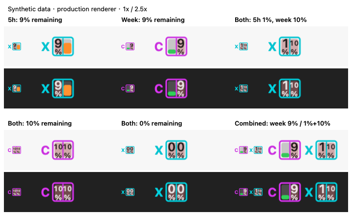
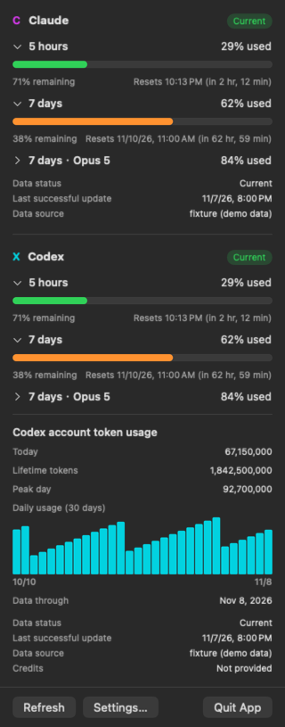
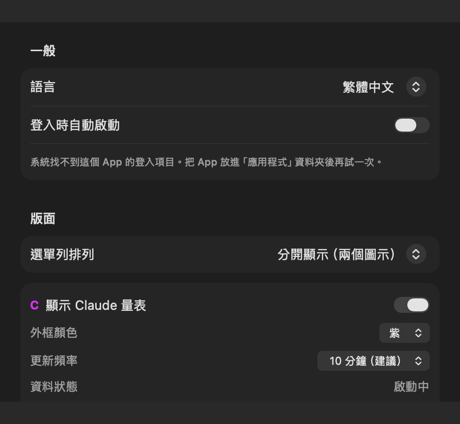
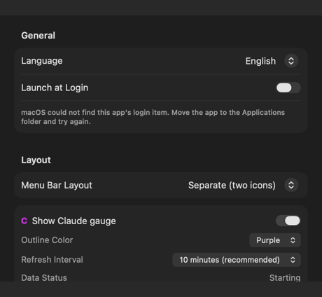

# Agent Usage Bar

**繁體中文** | [English](README.en.md)

macOS 選單列上的 Claude／Codex 額度計量器。不用打開用量頁面或輸入查詢指令，一眼看出訂閱額度用了多少。

> [!WARNING]
> Apple Silicon alpha 版本。預設採 ad-hoc 簽章、**未經 Apple 公證**，不含 Apple 可驗證的發布者身分；從網路下載後，macOS 預期會要求使用者手動允許開啟。
> 兩邊的額度都由本機 CLI 提供：Claude 執行固定的 `/usage` 查詢，優先讀結構化報告、沒有報告時才讀文字；Codex 使用 App Server 唯讀介面。格式不可信時 App 顯示「未知」，不猜數字。

> [!NOTE]
> **Claude 已知問題：** 少數情況下，背景 `/usage` 查詢會持續顯示「回應格式已改變」，直到使用者在 Terminal 手動啟動一次 `claude`。遇到時請啟動 Claude Code、完成可能出現的登入提示，再回到 App 按「重新整理」。App 不會代替你登入或修復憑證；詳細限制見下方「Claude」說明。

本專案與 Anthropic、OpenAI 均無隸屬關係，也未獲其背書。所有圖示為原創設計，未使用任何官方標誌。

## 示意圖

<p align="center">
  
</p>

<p align="center"><sub>新版共用外框圖示在原尺寸與 2.5 倍下的深淺色對照。圖像由正式繪圖器產生，所有用量均為合成資料。</sub></p>

<p align="center">
  
</p>

<p align="center"><sub>合併模式的 Claude／Codex 用量面板。數字全部來自合成 demo data，不是真實帳號資料。</sub></p>

<p align="center">
  
  
</p>

<p align="center"><sub>設定頁可在繁體中文與 English 之間切換；兩張圖同樣使用隔離的合成設定。</sub></p>

## 它做什麼

每個供應商在選單列有一個共用長方形量表，中線分成**左側 5 小時、右側 7 天**。填色高度代表已用比例，隨消耗往上長。每家固定 27 × 18 pt，兩家合併圖像為 57 × 18 pt；點開可以看到各時間窗的詳細數字。

- **外框顏色**代表是哪個供應商，可自訂。
- **內部填色**代表用掉多少（0–49% 綠、50–79% 橘、80–99% 紅、100% 已耗盡），不可自訂。顏色只看百分比，不採用各家自己的嚴重度判定 —— 否則同一個橘色在兩個量表上會代表不同的事。
- **剩餘 10% 以下直接顯示數字**，含 10% 與耗盡的 0%；5 小時與週額度各自在原本半格內顯示剩餘數字與 `%`，保持固定寬度。過期或限流時保留狀態標記。兩窗的已用與剩餘百分比也列在滑鼠提示、VoiceOver 與詳情；缺資料為灰槓，Claude 清單未列出限制時為灰色斜線，不當成 0%。
- **左側字母**（`C` / `X`）是不依賴顏色的第二個身分線索，色覺障礙或兩色選得太接近時仍分得出來。

當 provider **明確回報失敗**時，App 不會拿舊資料假裝是新的：有舊值就明示「過期」並標出取得時間，沒有可信資料就顯示「不可用」。設計原則是**未知狀態絕不畫成 0%**；Codex decoder 會拒絕範圍外或非整數百分比，不把壞資料 clamp 成看似可信的 0／100。

App 保留「限流」的視覺狀態，但目前兩條 live 路徑不一定會收到明確的 429：Claude CLI 可能改回本機快取，Codex App Server 則以一般 typed error 回報。因此不能承諾每次限流都有可靠的恢復時間。

## 產品定位：低權限、重隱私

Agent Usage Bar 不追求成為完整的 AI 使用分析平台；它主要回答：**目前的 Claude／Codex 訂閱額度用了多少，以及 Codex 帳號已使用多少 Token。** 為了這個目的，App 刻意不讀取或保存 `auth.json`、OAuth token、鑰匙圈憑證、對話 transcript、任務 JSONL 或本機資料庫，也不提供多帳號切換、跨裝置同步或自行建立的長期用量追蹤。

資料由已安裝且已登入的官方 CLI 代為查詢：Claude 執行固定的唯讀 `/usage`；Codex 使用 App Server 的唯讀 `account/rateLimits/read` 與 `account/usage/read`。後者直接提供累積 Token、最高單日 Token 與每日 buckets；App 不掃描本機 task 來重算。App 只留下畫面需要的解析結果與最近一筆快照；登入、續期與憑證保存仍由官方工具自己負責。

這個邊界是一項刻意的產品取捨，不是待補齊的功能清單。它沒有逐次／逐 task Token、cache Token 拆解、成本估算與多帳號管理，也因此不需要取得與那些功能相伴的對話內容和登入權限。當上游格式或資料新鮮度無法確認時，App 寧可顯示「未知」，不會為了維持畫面完整而改讀更敏感的資料來源。

## 目前狀態

支援 **Claude 與 Codex**，兩邊各自查詢、各自退避，也能獨立停用；其中一邊失敗不會拖累另一邊。

App 不累積自己的用量取樣，也不做預測。用量部分只落地設定值與**每個供應商最近一次的讀數** —— 永遠一筆，每次覆蓋。Codex 的這一筆可包含官方 `account/usage/read` 當下提供的每日 buckets，面板會把它畫成日用量圖；這是官方帳號快照，不是 App 長期蒐集出的序列。額度與 Token 統計各自保存取得時間，並依各自頻率更新；其中一邊失敗不會清掉另一邊的可信結果。圖表預設顯示最近 30 天，可在設定改為 5／10／15／20／30／60 天；這只改變畫面範圍，不會刪除 snapshot 內的官方資料。面板也會顯示今天的官方 bucket；若上游尚未回報今天，明示「尚未回報」，不把缺值當成 0。設定另有一份隱私安全的錯誤紀錄，保存時間、供應商、App 定義的錯誤類型與封閉詳細原因；每筆可展開查看並複製完整說明。原始回應與 provider 任意文字仍不保存。紀錄預設保留 5 天，可改為 3／7 天或隨時清除。

保存那一筆是為了限流：App 原本什麼都不留，所以每次啟動就立刻發一次請求，關掉再開十次就是十次。現在啟動時先用上次的讀數，額度或 Token 統計各自超過所選更新間隔才重新查詢。

> [!IMPORTANT]
> correctness、穩定性與保守瘦身項目均已完成，並通過專案的完整驗證。現行測試範圍與證據見 [Verification](docs/VERIFICATION.md)。

## 執行形態

平常是選單列小工具，**不佔 Dock**。在 Launchpad 或 Finder 點它（不論是否已在執行）會開啟設定視窗，這時才出現 Dock 圖示；關掉視窗後 Dock 圖示消失，選單列量表照常運作。

兩個供應商都關閉時，選單列會保留一個中性圖示作為入口 —— 否則就再也打不開設定了。

選單列空間不夠時，設定裡可以切成**合併顯示**：兩家放在同一個選單列項目，減少一份系統留白，並保留各自的字母與外框顏色。點下去兩個供應商的讀數都看得到。

popover 會先依內容完整展開，螢幕真的放不下時才啟用捲動。設定視窗重新開啟時會移到目前桌面，不會把使用者帶回先前開啟它的 Space。

介面可在設定中切換**繁體中文／English**，不需跟隨 macOS 系統語言；選擇會保存，popover、設定頁、選單與 VoiceOver 會一起切換。

可設定**登入時自動啟動**。

設定的「診斷紀錄」可展開及複製每次失敗的詳細說明。Codex 紀錄會指出哪項查詢失敗、當時回報的錯誤碼與可辨識的原因，以及是否沿用背景程序。同一查詢恢復後，也能查看成功時間及是否換過程序。它不保存原始回應、憑證、執行檔路徑或供應商提供的任意文字，並固定限制為最新 200 筆。

## 安裝

自己建置（見下方「開發」），或從 Releases 取得 DMG 與對應的 `.sha256`，先驗證：

```bash
shasum -a 256 -c Agent-Usage-Bar-<版本>-alpha.1-b<build>-<架構>.dmg.sha256
```

開啟 DMG，把 `AgentUsageBar.app` 拖進「應用程式」。

這個 App 預設採 ad-hoc 簽章且未經 Apple 公證，因此沒有 Apple 可驗證的發布者身分。建置機器上的 `spctl` 已回報 `rejected`；從網路下載後，macOS 預期會先阻擋一般雙擊，並顯示「Apple 無法驗證此 App 是否包含惡意軟體」。新版 macOS 的初次對話框可能只有「移到垃圾桶」和「取消」。

要放行請走：

1. 雙擊一次（讓系統記錄這次被擋）
2. **系統設定 → 隱私權與安全性**，往下捲
3. 找到「已阻擋 AgentUsageBar」的訊息，按「**仍要打開**」
4. 再確認一次

較舊的 macOS 可以用「按右鍵 → 打開」的捷徑，新版已移除。

> [!NOTE]
> 上述步驟尚未在乾淨的第三方機器上走完。已確認的是建置機器上的簽章與 DMG 檢查均通過，而 `spctl` 不接受目前未公證的成品；真正從瀏覽器下載、帶有 quarantine 標記的安裝體驗仍須用另一台 Mac 驗收。

`.sha256` 只能證明 DMG 位元組與你取得的 checksum 相同；它必須來自可信或獨立的發布管道才有意義，也不能取代 Developer ID 與 Apple 公證所提供的發布者身分。

需求：macOS 14 以上、Apple Silicon，以及本機已登入的 Claude Code／Codex CLI（依啟用的 provider 而定）。

## 資料怎麼來的

### Claude

執行 Claude Code 自己的唯讀指令，讀它回報的數字：

```bash
claude --safe-mode --no-session-persistence -p "/usage" --output-format json --verbose
```

實測不跑模型、不消耗對話額度（`num_turns=0`，所有 token 計數為 0）。`--safe-mode` 沿用既有登入但避開 hooks、plugins、MCP 與專案設定；`--no-session-persistence` 讓這次呼叫不留下 session；`--verbose` 讓輸出附上結構化的用量報告，App 優先讀它，沒有時才解析印出的文字。

**App 不讀取你的鑰匙圈憑證。** 早期的直接 OAuth／Keychain 原型已完整移除，公開版本不保留該路徑或自動 fallback；登入與憑證更新都由 Claude Code 自己處理。

執行的參數是寫死的常數，設定裡改不了，也不受任何回應影響。驗證腳本有護欄擋住 shell、擋住 `doctor`／`mcp`／`auth`／`login`，並逐字比對那份參數清單。

#### 已知問題：可能需要先啟動一次 Claude Code

實機曾出現背景 `/usage` 查詢連續回傳 App 無法辨識的內容，畫面因此顯示「回應格式已改變」並保留上一筆讀數；在 Terminal 手動啟動一次互動式 `claude` 後，再按「重新整理」即恢復。這可能與 Claude Code 尚未完成登入、續期或本機狀態初始化有關，但目前只有現象與 workaround，沒有官方文件足以確認根因。

遇到時請：

1. 在 App 的錯誤提示按「複製指令」，或自行在 Terminal 輸入 `claude`。
2. 若 Claude Code 要求登入，完成登入；若直接進入互動介面，確認能正常啟動後即可離開。
3. 回到 Agent Usage Bar，等待 20 秒防連點間隔後按「重新整理」。

App 刻意不自動啟動互動式 CLI、不執行登入，也不讀取或修改憑證。如果上述步驟仍無法恢復，請到設定的「診斷紀錄」展開最新一筆並複製 App 產生的安全錯誤說明，再附在 issue；不要貼出 Keychain、token 或 Claude 的原始完整回應。

### 數字有多新

`/usage` 的輸出裡有兩份同樣的數字：一份結構化的用量報告，一段印給人看的文字。兩者在查不到資料時表現不同。

**有報告時。** `rate_limits` 或 `limits` 為 `null` 表示沒有取得讀數；App 保留上一筆並標示過期，不讀可能是舊快取的文字。有實際清單時只讀列出的額度，缺列或空清單不等於 0%，也不以文字補齊。2026-10-11 的單一版本測試曾觀察到短暫沿用剛取得的報告，但沒有官方保證的資料年齡上限。

**沒有報告時**（較舊的 Claude Code，或不符合附報告條件的登入），App 只能讀文字，而文字連不上時會**安靜地退回 Claude Code 的本機快取**。2026-08-28 的一次受控觀察中，只有 Wi-Fi 的 Mac 在關閉 Wi-Fi、跨過已知重設時間後，仍回傳上一個時間窗的完整舊資料；恢復 Wi-Fi 後再次查詢才取得新窗資料。指令耗時不能用來判斷是否連網，因為實測的離線與連網時間互相重疊。輸出本身也沒有「這筆數字是幾點拿到的」。

所以 App 用重置時間當守門，不論數字來自哪一份：重置時間還沒到，代表這筆快取寫在當前時間窗內；重置時間已經過了，代表它描述的是一個結束了的窗，直接顯示「不可用」而不是那個百分比。

每個有提供的基本時間窗都各自套用這道守門；任何一個已跨過 reset，整份查詢就不可用。文字路徑仍要求 session 與 weekly 齊備，結構化清單則容許缺列。CLI 指定的 IANA timezone 必須能辨識，不猜本機時區。

**守門擋不到的是窗內的落後。** 只能讀文字時，最壞情況是一筆最多 5 小時舊、但看起來正常的數字。這是相對舊路徑的實質退步，寫在這裡而不是藏起來。用量報告是官方標示的實驗性欄位，日後若不再提供，App 會回到這個情況。

### 憑證與登入

App **不執行登入、不啟動登入流程、不寫入任何憑證**。Claude Code 沒登入時，面板提供 `claude` 讓你自己去終端機跑；找不到執行檔或版本太舊時不給指令，因為那要的是安裝或更新。

要講精確的話：App 不再**讀**憑證，但它執行的指令連網時需要一張有效的票，所以 Claude Code 可能在那次呼叫裡順手續期。「App 完全不碰憑證」是不準確的說法。

GUI App 的 `PATH` 跟終端機常常不一樣，所以設定 → 資料來源可以指定 `claude` 執行檔路徑；留空時依序檢查常見安裝位置與目前環境。App 只驗證該路徑是可執行檔，不會替第三方或自行替換的同名程式驗證開發者身分，因此只應選擇你信任的 Claude Code 安裝。

### 更新頻率

額度預設 **10 分鐘**（每天約 144 次更新），可改成 1／3／5／10／30／60 分鐘。Codex Token 統計另有獨立頻率，預設 **1 小時**，可選 15／30 分鐘或 1／2／3／6 小時。App Server 的額度通知仍可在排程之外更新畫面；按「重新整理」則同時要求最新額度與 Token 統計。兩條排程都受 20 秒防連點底線約束，睡眠、螢幕關閉或鎖定時一起暫停。

這個預設值在 0.3.1 從 30 分鐘降下來。舊路徑之所以保守，是因為 App 自己打端點、自己控制重試，踩到限流會卡進一個爬不出來的迴圈；現在查詢由 Claude Code 執行，那個陷阱不在我們這邊了。

**但還是不要設太短，理由是回饋而不是風險。** 被限流時 CLI 多半會像離線那樣安靜地退回快取，所以過度輪詢**不會有任何錯誤訊息** —— 你只會拿到舊數字而不知道為什麼。加上最短的時間窗是 5 小時，每分鐘查一次的讀數不會比每十分鐘查一次更有意義。

睡眠、螢幕關閉與鎖定時會暫停輪詢；喚醒或解鎖時恢復排程並嘗試更新。現行 `FetchPacing` 仍會尊重 20 秒防連點底線，也可能沿用仍在更新間隔內的讀數。

### Codex

直接啟動本機 Codex CLI 的 App Server：

```text
codex app-server --listen stdio://
```

App 透過 JSONL 只送出初始化、`account/rateLimits/read` 與 `account/usage/read`，並接收 `account/rateLimits/updated` 通知。Token 總量與每日數字直接採用 `account/usage/read` 的官方帳號統計，不解析 task，也沒有 cached-input Token 明細。App 不讀取 `auth.json`、任務 JSONL、SQLite 或快取，也沒有任何登入、登出、購買、寄信或消耗 reset credit 的方法。

App Server 是單一長駐子程序，不會每次更新就重開。停用 Codex、變更 CLI 路徑或結束 App 時，只終止自己啟動的那一個程序；正常停止無效時，短暫等待後只強制結束同一個精確程序。額度預設每 10 分鐘做一次保險查詢，Token 統計預設每 1 小時查詢；推播只更新實際提供的額度欄位，不會清掉 weekly／Credits／plan／Token 統計，也不會延後兩條排程。若 read 逾時，App 會捨棄舊連線，下次重新 initialize；正常連線仍會長駐。OpenAI 尚未公開這些唯讀查詢的最低間隔或固定懲罰窗，預設值是本 App 的保守設定，不是官方限制。

GUI App 的 `PATH` 常與終端機不同，因此設定 → 資料來源可指定 Codex 執行檔；留空時依序檢查常見安裝位置與目前環境。App 只驗證路徑可執行，不驗證供應商簽章；請只選擇你信任的 Codex 安裝。查詢不觸發模型推理，也不消耗一般 Codex 對話額度。

## 開發

```bash
open macos/AgentUsageBar/App/AgentUsageBar/AgentUsageBar.xcodeproj
```

選 `AgentUsageBar` scheme 與 `My Mac`，按 Run。

```text
macos/AgentUsageBar/          Swift Package 根目錄
├── Package.swift
├── Sources/
│   ├── AgentUsageBar/        App 層；Debug 另含合成 render／self-test 情境
│   └── UsageMeterCore/       純邏輯，不含 UI，可獨立測試
├── Tests/UsageMeterCoreTests/
└── App/AgentUsageBar/
    ├── AgentUsageBar.xcodeproj
    └── AgentUsageBar/        Info.plist 與 Resources/AppIcon.icns
```

Xcode target 用同步資料夾（synchronized folder）引用 `Sources/AgentUsageBar`，所以新增檔案自動屬於 target，不會發生「檔案沒加進 target、編得過但 App 找不到」的狀況。

驗證：

```bash
./scripts/verify.sh
```

它原本設計為單一驗證入口，會跑單元測試、實際 Xcode App target、`NSStatusItem`、SwiftUI render 與靜態護欄。

腳本不會用正式 App 身分執行診斷：它複製一份臨時 App、改用唯一 bundle identifier 並 ad-hoc 重簽，再執行 self-test 與 render。正式設定在前後會做匿名指紋比對；測試設定一定清除，臨時 App 會在系統可用 `trash` 時移入垃圾桶，否則明確回報保留路徑。細節見 [VERIFICATION.md](docs/VERIFICATION.md)。

打包 DMG：

```bash
./scripts/package_dmg.sh --preflight
./scripts/release.sh plan
```

`preflight` 與 `plan` 都只讀。真正建立候選版時，維護者確認 plan 後才執行 `release.sh prepare`；它會提交單一版本檔、跑完整驗證，再建立互相綁定的 DMG、checksum 與 candidate manifest。同名成品不會被覆蓋，tag 也只在人工安裝驗收後由 exact manifest 建立。**這些腳本都不會安裝、push 或建立遠端 Release。** 完整步驟見 [docs/PACKAGING.md](docs/PACKAGING.md)。

簽章設定見 [docs/SIGNING.md](docs/SIGNING.md)。

## 文件

- [Contributing](CONTRIBUTING.md) —— 開發環境、驗證方式與 pull request 規則
- [Security policy](SECURITY.md) —— 漏洞回報、安全邊界與已接受風險
- [Architecture](docs/ARCHITECTURE.md) —— 分層、目錄結構，以及兩個 provider 的共用契約與刻意差異
- [Safety](docs/SAFETY.md) —— 唯讀邊界、資料新鮮度守門、限流安全、已知的未驗證項目
- [UI spec](docs/UI_SPEC.md) —— 量表視覺語言（兩個 provider 必須一致的部分）
- [Claude 的額度資料來源](docs/CLAUDE_USAGE.md) —— 固定的唯讀指令、文字格式與容錯策略
- [Codex 的額度資料來源](docs/CODEX_USAGE.md) —— App Server 協定、欄位與容錯策略
- [已退場的鑰匙圈路徑](docs/LEGACY_KEYCHAIN_PATH.md) —— 舊的憑證＋端點做法、當初踩出來的知識、什麼情況值得走回去
- [做過但行不通的事](docs/WHAT_DID_NOT_WORK.md) —— 推翻過的決定與踩過的坑
- [Verification](docs/VERIFICATION.md) —— 驗證跑哪些檢查，以及那些護欄的由來
- [Packaging](docs/PACKAGING.md) —— DMG 打包與發布
- [Signing](docs/SIGNING.md) —— 免費與付費憑證分別解決什麼問題
- [Roadmap](docs/ROADMAP.md)

## 授權

本專案採用 [Apache License 2.0](LICENSE)。著作權與歸屬資訊見 [NOTICE](NOTICE)。
